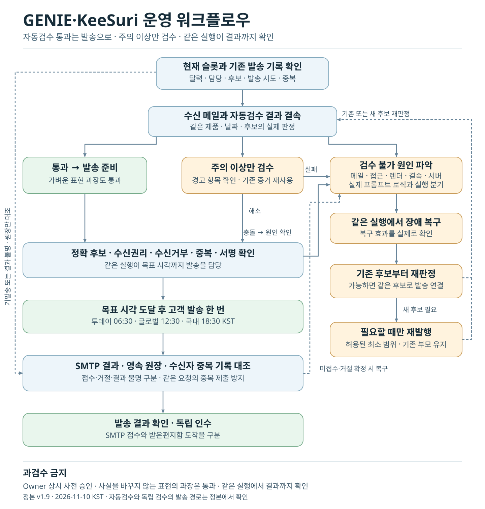
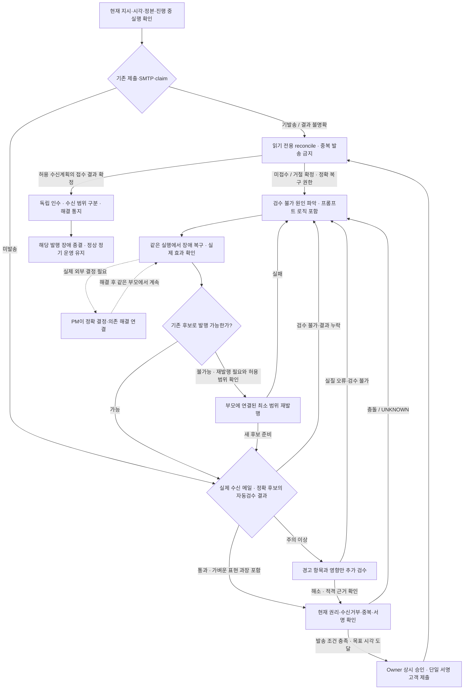

# GENIE·KeeSuri 운영 워크플로우 정본

> **작업 전 필독:** [발행 실패 방지 — 반드시 읽고 피해야 할 절차](GENIE_KEYSURI_FAILURE_PREVENTION_REQUIRED.md). 2026-11-05·06의 실제 요청 크기 거부, 교정본 이미지 경로 오류, 담당자의 불필요한 보류·승인 대기와 검수 자료 형식 오류를 기록한다. 실제 Owner의 직접 지시와 현재 serving·권한·원장이 우선한다.

문서 ID: `GENIE-KEYSURI-OPS-WORKFLOW` · 버전 1.9 · 갱신 2026-11-10 KST

담당: 기존 GENIE 운영 담당과 기존 조정 PM. 발행일 정기 슬롯·진행 중인 승인 복구·23:55 일일 마감에 적용한다.

## 1. 정본의 범위와 완료 기준

이 문서는 세 제품의 발행 절차 정본이다. **실제 수신 메일과 자동검수 결과를 정확 후보에 결속 → 통과 건은 발송 준비, 주의 이상은 해당 항목 검수 → 정시 단일 제출 → 발송 결과 대조**로 이어간다. 검수 불가는 같은 실행에서 원인을 파악하고 장애를 복구한 뒤, 기존 후보로 해결할 수 없는 경우에만 재발행한다. 작업창 `WORKFLOW.md`와 임시 보고서는 이 문서를 가리키는 안내와 과거 증거다.

정책·권한은 최신 실제 Owner 지시와 유효한 현재 계약을, 실행 상태는 현재 서비스·서명·publication/outcome·claim·실제 수신 증거를 따른다. 문서나 성공사례 자체는 새 권한·예산·grants·운영 변경 승인이 아니다. 현재 수신자 수·모델·SHA·잔여 횟수는 매 실행 정본으로 확인하며 과거 사례에서 상속하지 않는다.

**조치 PASS·미완료 기록·계획·다음 heartbeat 대기는 완료가 아니다. 같은 부모에서 필요한 복구 발행과 실제 고객 제출·결과 대조·독립 인수·해결 통지까지 연결한다.** 실제 외부 결정만 필요한 범위로 격리하고 PM이 결정 수신과 후속 실행을 연결한다. 제약을 무시하거나 실패를 PASS로 만들어 완료를 꾸미지는 않는다.

2026-10-27 Owner 직접 지시: **“워크플로우 중 나의 승인은 묻지 않고 진행한다.”** 같은 부모의 확인된 결함 수정·지정 작업자 검수·필요한 운영 반영·허용 복구·새 후보 전수 QA·정상 signed 고객 발송·결과 대조·독립 인수에 단계별 Owner 재승인 대기를 만들지 않는다. PM이 정확 입력·효과·유한 예산·담당·실패 반환을 기술 계약으로 정하고 다음 단계까지 연결한다. 과거의 더 좁은 통상 탭 접근 해석이나 단계별 승인 대기 문구와 충돌하면 이 지시를 우선한다. 다만 실제 도구/전송 거부를 우회하거나 과거 소진을 환급하지 않으며, 다른 제품·공급자·모델·무제한 비용·grants/Secrets/Scheduler 변경, dirty 덮어쓰기, QA/권리 UNKNOWN의 PASS, 중복 발송을 허용하지 않는다. 실제 기술 차단은 원인과 현재 효과를 보고하되 같은 승인 질문을 반복하지 않는다.

**2026-11-10 Owner 직접 지시 — 정기 고객 발송 상시 사전 승인.** 투데이 지니·키수리 글로벌·키수리 국내의 정기 발행에 적용한다. 정확 후보의 실제 운영자 수신 메일과 검수 판정이 결속되고 현재 발송 조건을 충족하면, 담당자가 발행일의 해당 목표 시각(06:30·12:30·18:30 KST)부터 기존 경로로 한 번 제출하고 결과를 대조한다. 슬롯마다 Owner의 재승인이나 확인 클릭을 기다리지 않는다.

발행 운영 기록에는 `Owner 상시 사전 승인(2026-11-10 직접 지시)`과 실제 검수 방식·제출 담당·시각을 구분해 남긴다. `HUMAN_OWNER` 직접 검수·클릭은 실제 확인 기록으로만 표시한다. 개별 HOLD·철회, 수신권한·수신거부·중복·서명 조건과 예외 복구 계약은 현재 원장과 계약을 따른다. 서버가 요구하는 증거가 빠졌다면 발송 경로 장애로 처리해 같은 실행에서 복구한다.

서로 다른 완료 의미:

| 단계 | 필요한 증거 | 대신할 수 없는 것 |
| --- | --- | --- |
| 자연 생성 | 해당 날짜·slot의 실제 scheduled run | 예약 ACTIVE·수동 복구 |
| 발송 전 검수 | 정확 후보의 유효한 자동검수 통과, 또는 주의 이상 항목의 검수와 해소 증거 | 메일 제목의 표시·생성 성공·로컬 테스트·부모 후보 PASS 복사 |
| 고객 발송 | 기존 signed 결과 + SMTP 수량 + 별도 영속 outcome 대조 | HTTP 200·shadow PASS·운영자 메일 |
| 고객 도착 | 정확 run에 결속된 실제 수신 원본 또는 수신자의 직접 확인 | SMTP 접수·해결 통지 메일 |
| 발행 장애 종결 | 필요한 복구·QA·발송·원장 대조·독립 인수·해결 통지 | 코드 수정·부분 PASS·보고서만 작성 |

### 1.1 자이언트 스텝: 문제 해결부터 실제 종결까지 연속 수행

2026-10-27 Owner 직접 지시: **“워크플로우 문서 업데이트 해. 자이언트 스텝에서 승인 묻지말고 문제를 해결해.”** 앞선 단계별 승인 대기를 제거한 지시를 실제 실행 순서에 적용한다.

- **같은 실행에서 진단 → 장애 복구 → 기존 후보 재판정 → 필요한 경우만 재발행 → 새 후보 자동검수 판정 → 고객 제출 → 결과 대조 → 독립 인수까지 이어간다.** 보고, 다음 예약, 단계별 승인 대기로 실행을 끊지 않는다. 목표 시각까지 기다려야 할 때도 같은 실행이 발송을 맡는다.
- PM이 현재 허용 범위·실제 담당·최소 전달 자료·유한 예산·종료 조건을 한 실행 계약으로 묶고, 정상 결과를 받으면 다음 단계를 즉시 연결한다. 통상 기술 판단·오류 수정·허용 반영은 단계 ACK 없이 이어간다. 주의 이상은 영향 항목을 검수한다.
- 정상 실패는 실패 원본과 소비를 보존하고 가설·접근법을 바꿔 같은 부모에서 해결한다. 사용 가능한 현재 계약 안에서 최소 수정과 필요한 재검수만 수행한다. 이미 소진된 호출을 환급하거나 자동 반복 호출·재발행·재제출로 바꾸지 않는다.
- 실제 권한/전송 거부·예산 소진·필수 증거 접근 불가처럼 현재 범위에서 해결할 수 없는 부분은 정확 원인·시도한 조치·실제 발송 상태·의존 책임을 기록한다. 이를 Owner 재승인 대기로 이름만 바꾸거나 같은 질문을 반복하지 않는다. 영향 없는 정상 슬롯과 허용 작업은 계속한다.
- 계획·문서 수정·로컬 PASS·장애 기록만으로 제품 문제 해결을 선언하지 않는다. 고객 제출·결과 대조·독립 인수의 실제 증거로 완료를 판정하고, 실수신 UNKNOWN과 정시 발행 실패는 그대로 남긴다.

## 2. 전체 흐름

[SVG 차트 원본](diagrams/genie-keysuri-operating-workflow.svg) · 아래 Mermaid와 같은 절차를 그린 저장소 배포용 도식이다. 절차가 바뀌면 두 표현을 함께 갱신한다.





되돌림 화살표는 같은 POST·유료 호출·소진 계약의 자동 반복이 아니다. 기존 효과·남은 유한 계약·거부를 먼저 확인한다. 미확인/접수된 대상을 재발송하지 않는다. 일반 태스크의 종료 후 휴식을 정기 운영 전체 중지로 확대하지 않는다.

### 과검수 금지 — 2026-11-10 Owner 직접 지시

| 실제 상태 | 같은 실행에서 이어갈 단계 |
| --- | --- |
| 운영자 메일 수신 및 정확 후보의 자동검수 통과 | 추가 본문·원문·화면 검수를 생략하고 발송 조건 확인으로 이동한다. 메일의 도착, 제품·날짜·후보 결속, 정시·수신권리·수신거부·중복·서명은 발송 조건으로 확인한다. |
| 사실을 바꾸지 않는 다소 과장된 표현, 문체 또는 편집 참고만 있음 | 통과 처리한다. 추가 검수·교정·재발행 사유로 삼지 않는다. |
| 주의 이상 | 경고가 가리킨 부분과 변경 영향을 한 번 확인한다. 동일 버전·바이트·권리의 유효한 근거는 재사용한다. 수치·사실·시점·안전·권리의 실질 오류나 불확실성은 해당 항목에서 확인한다. |
| 검수 불가, 자동검수 결과 누락 또는 증거 충돌 | 메일·접속·원문·렌더·데이터·서버 가드와 실제 프롬프트 로직에서 정확 원인을 확인한다. 같은 실행에서 장애를 복구하고 기존 후보를 다시 판정한다. 새 후보가 꼭 필요하고 유효한 범위가 확인됐을 때만 재발행한다. |

운영자 메일 제목이나 본문의 PASS 표기만으로 통과를 판정하지 않는다. 실제 수신 원본에 결속된 운영 서버의 판정을 사용한다. 자동 통과에는 자동검수의 실제 결과와 시각을 남긴다. 독립 검수를 수행했다고 서명하거나 고객 화면에 표시하려면 해당 검수 증거가 필요하다.

**자동검수 발송 경로:** [서명 게이트](../../delegated_gate.py)는 `DELEGATED_AUTOMATIC_QA`와 독립 검수 근거를 구분한다. 자동검수 분기는 현재 자연 발행 후보, 생산자의 품질 판정, 정확 수신 MIME과 이미지, 목표 시각과 기존 수신·서명·중복 조건을 확인한다. 독립 검수 증거와 운영자 클릭을 요구하지 않는다. 배포 SHA를 대조해 운영 서버와 helper가 이 분기를 실제로 지원하는지 확인한다. 지원되지 않으면 발송 경로 장애로 처리한다.

### 2.1 정상 발송 지연을 줄이는 실행 규칙

정상 발송과 장애 개발의 실행 경로를 구분한다. 정상 후보의 발송 경로에 코드 저술·제품 회귀시험·CI/배포를 매번 끼우지 않는다. 실제 결함이 있을 때만 해당 후보를 장애 경로로 연결하고, 다른 정상 제품의 검수·발송은 계속한다.

| 지연을 만드는 방식 | 적용할 실행 방식 |
| --- | --- |
| 자동검수 통과 건을 다시 읽거나 화면을 수집 | 정확 후보에 결속된 자동검수 결과를 사용한다. 주의 이상에 필요한 독립 읽기와 증거 수집은 서로 의존하지 않는 범위에서 병렬로 처리한다. |
| 각 단계 결과 뒤 재승인·단순 ACK·다음 heartbeat를 대기 | 같은 실행이 자동검수 판정, 해당 경고 검수, 원인 확인과 복구, 정시 단일 제출, 결과 대조까지 책임진다. PM 독립 인수는 4.7에서 수행한다. |
| 매 실행 모델명을 수기로 추정하고 공유 설정을 임시 변경 | 실제 reviewer metadata·검증된 helper/의존성과 기존 직렬화 경로를 사용한다. 입력 구조·모델 식별·기존 수신 결속 충돌은 Secret 취득·서명 POST 전에 확인한다. 공유 설정 변경이 필요하면 기존 허용·공통 직렬화·정확 원복 조건을 먼저 충족한다. |
| 작은 오류마다 전체 파일·시험을 다시 작성 | 기존 적격 fixture·시험과 실패 원본을 재사용해 최소 블록을 수정한다. 변경 영향에 맞는 의미 있는 회귀만 수행하고, 새로운 변경·실패·미해결 우려 없이 통과한 검사를 반복하지 않는다. |
| 이미 받은 자료를 다시 모으거나 과거 PASS를 새 후보에 복사 | 동일 SHA·버전·lineage에 결속되고 현재도 유효한 증거를 재사용한다. 새 후보는 자체 자동검수 판정으로 돌아간다. 현재 권리·억제/수신거부·중복·claim·최종 guard는 제출 직전 확인한다. |

증거 수집 병렬화는 새 모델/작업자·권한·비용을 만드는 지시가 아니다. 상태 변경·공유 설정 변경·서명/제출·claim 처리는 기존 직렬화와 단일 제출 경로를 지킨다. 기존 불변 수신 영수증은 그 영수증의 정확 계획과 현재 권리를 대조하며, 새 계획으로 덮어쓰거나 충돌 guard를 없애지 않는다.

이 절은 담당자의 실행 원칙을 정한다. 고정 실행 환경·모델 metadata 결속·증거 수집 자동화 등 구현이 필요한 부분은 현재 구현/미구현과 검증 범위를 분리해 기록한다. 문서 개정 자체를 런타임 개선·배포·자동 발송 성공으로 보고하지 않는다.

### 2.2 조기 생성·검수와 고정 발송 시각 — 2026-11-03 Owner 직접 지시

Owner는 “생성 시간을 모두 한시간씩 앞당기고, 발송시간에 맞춰 보낼 수 있도록 검수도 앞당겨”라고 지시했다. 이는 생성·사전점검·기존 검수 예약의 시각 변경 권한이며 추가 유료 생성·재발행·발송 횟수나 과거 소진 환급이 아니다. 3절의 운영 일정과 실제 예약 설정을 대조한다. 실제 생성·검수·고객 발송 시각을 구분한다.

조기 창에서 실제 수신 메일을 정확 후보와 자동검수 결과에 결속한다. 주의 이상에 한해 영향 항목을 검수하고, **서명하지 않은 준비 증거**를 보존한다. 고객 발송 목표 시각 전에는 canonical signed helper와 그 수신 결속 등록·수신계획 prepare를 호출하지 않는다. 같은 실행이 목표 시각을 기다리며 발송을 소유한다. 발송 직전 운영 가드에서 시각을 확인한다.

발송 직전 동일 후보·검수 결과·수신 메일의 결속과 현재 ACTIVE grant·억제/수신거부·claim·all-writers/final guard를 확인한다. 변경 없는 본문·원문·화면 검수는 되풀이하지 않는다. 증거의 실제 시각과 서버 신선도 기준을 지킨다. 준비가 끝나면 같은 담당이 **06:30/12:30/18:30에 도달한 뒤** 해당 판정을 지원하는 기존 서명 경로로 1회 제출한다. 이후 별도 outcome·수량·claim·독립 인수·해결 통지까지 계속한다.

Today는 같은 날 Owner가 **“06:05분 생설으로 기준을 잡아.”**라고 직접 확정했다. 현재 자연 생성은 **06:05**, 사전점검은 **05:20**, 검수 접근 준비는 **06:00**, 고객 발송 목표는 **06:30**이다. 미국장 마감 후 생성 기준을 사용하며, 실제 원자료의 최종 마감·날짜·시점과 불확실성을 전수 검수한다. 06:05라는 시각 자체가 지연된 공급자 자료의 확정 마감 증명은 아니다. 전일 날짜의 live값을 SETTLED로 인정할 수 있는 기존 경로의 한계는 보존하고 장중/미확인 자료를 확정 마감 PASS로 바꾸지 않는다. 선택 대기는 해소됐으며, 이 미래 시간 변경은 이전 Today 후보의 추가 복구·재발송 권한과 별개다.

## 3. 시작 전 조건과 실행 시점

- [ ] 현재 KST, 실제 실행 actor/reviewer 모델, 진행 중인 동일 부모 실행을 확인한다.
- [ ] 최신 직접 지시·현재 authority/grant·허용 효과/횟수·소진·거부·HOLD·dirty를 확인한다.
- [ ] 현재 checkout HEAD/dirty와 serving commit/revision/digest, helper bytes/hash·의존성을 대조한다. 적격인 동일 실행 원본은 재사용한다.
- [ ] 서비스·받은 메일·원문·이미지/권리·최종 렌더·영속 원장에 기존 승인 접근이 있다. UNKNOWN을 PASS로 채우지 않는다.
- [ ] 비밀·쿠키·토큰·인증 헤더·원문 메일·수신 주소를 로그/공개 문서/모델 작업자에게 전달하지 않는다.

현재 serving과 맞는 `genie_schedule_policy.py` 및 `korea_public_holidays.py`에서 **달력 coverage를 먼저**, 이어 발행일을 판단한다. 범위 밖을 비공휴일로 간주하지 않는다. 달력 범위 미확인은 HOLD다.

| 제품 | 현재 preflight KST | 현재 자연 생성 KST | 조기 검수 시작 KST | 고객 발송 목표 KST |
| --- | --- | --- | --- | --- |
| `today_genie` | 05:20 | 06:05 — 미국장 마감 후 생성 기준 | 06:00 접근 준비, 후보 준비 즉시 자동검수 결과 판정 | 06:30 유지 |
| `keysuri_global_tech` | 10:45 | 11:30 | 11:25 접근 준비, 후보 준비 즉시 자동검수 결과 판정 | 12:30 유지 |
| `keysuri_korea_tech` | 16:45 | 17:30 | 17:25 접근 준비, 후보 준비 즉시 자동검수 결과 판정 | 18:30 유지 |

정기 발행을 시작하는 평일 예약 프롬프트는 투데이 06:08, 글로벌 11:33, 국내 17:33 KST다. 위 표의 조기 접근 준비 시각 및 고객 발송 목표와 구분한다.

`scheduled_slot`·publication·claim 식별자는 기존 고객 발송 목표06:30/12:30/18:30을 유지한다. 실제 생성 시각은 run timestamp/원본으로 별도 기록한다. Today 생성06:05와 Global/Korea 생성11:30/17:30으로 바꾸며 날짜·제품·동일 슬롯 중복 가드를 바꾸지 않는다. 기존 자동교정은 Today6–7시 창을 유지하고 Global/Korea 시간창만 한 시간 앞당기며 max1/parent·소비·child제외·고객미발송 경계를 유지한다. timeout 고객 발송 경로는 기존 퇴역 상태를 유지한다. 같은 날 이미 끝난 슬롯은 새 생성·재발송하지 않는다.

지난 슬롯을 따라잡는 무단 수동 생성은 하지 않는다. 진행 중인 복구는 다음 예약이나 Owner 독촉을 기다리지 않고 이어간다. 23:55에는 세 제품의 실제 단계·수량·지연·수신 범위를 한국어 Markdown으로 작성해 기존 작업창에 전달한다. 그 외 무변화는 조용히 처리한다.

### 3.1 발송 시각과 지연 판정

후보 준비를 관측하면 즉시 검수를 연결한다. +3/+8/+13/+18분에는 기존 실제 검수를 수행하거나 진행 중 검수·서명·SMTP 원본을 확인해 누락을 처리한다. 이 시각을 최초 착수나 다음 단계 승인까지 기다리는 시점으로 쓰지 않으며, 완료된 동일 검수나 제출을 다시 실행하지 않는다. 이 원칙을 이유로 기존 heartbeat·운영 Scheduler의 대상·주기·설정을 변경하지 않는다.

정상 발행은 **고정 고객 발송 목표 시각부터 SMTP 접수까지 10분 이내**를 개선 목표로 두고 실제 슬롯으로 검증한다. 조기 생성부터 발송 목표까지의 예정된 선행 시간(Today25분, Global/Korea60분)은 발송 지연으로 계산하지 않으며 생성 선행 시간과 발송 지연을 각각 기록한다. 이 개선 목표와 자동검수 판정 기준은 각각 적용한다. 마지막 +18분 점검까지 필수 검수·제출이 끝나지 않으면 정시 운영 점검 미달로 기록한다. 제출 결과가 불명확하면 그 상태를 분리하고 먼저 reconcile한다. 이후 허용된 복구가 성공해도 정시 자연 발행 실패를 소급해 PASS로 바꾸지 않는다. 지연만으로 새 재발행·재발송 횟수를 만들지 않는다.

기존 슬롯 원본에 예약/생성/후보 준비/검수 시작·종료/서명 제출/SMTP 접수 시각, 단계별 대기·재작업 원인과 호출 소비를 기록한다. 다음 슬롯 10건의 고객 발송 목표 대비 지연 p50/p95·10분 목표 달성 수·+18분 미달 수·필수 검수 누락 수를 대조한다. UNKNOWN 시각은 추정값으로 채우지 않고 지표의 확인 표본 수와 함께 남긴다. 이 집계를 위한 수동 생성·고객 시험메일·새 유료 호출은 하지 않는다.

## 4. 정상 검수·고객 발송 절차

### 4.1 후보와 기발송 상태 식별

서비스에서 run/product/date/slot·자연/수동 실행·parent/child·frozen SHA를 식별하고, 같은 publication attempt·별도 outcome·SMTP·claim을 읽는다.

예상: 정확 후보와 기존 효과가 결속된다. 실패/충돌/기존 제출이면 새 sender를 시작하지 않고 4.6으로 간다. UI `pending_review`만으로 미발송을 단정하지 않는다.

### 4.2 수신 메일 결속과 자동검수 결과 분기

실제 받은 message ID/시각/raw MIME bytes/SHA와 저장 운영자 HTML·제목·CID·run binding을 대조한다. 현재 계약의 정확 허용 receipt suffix/변환만 인정하고 immutable 원본을 덮어쓰지 않는다.

정확 후보의 실제 자동검수 결과를 대조한다. 통과와 가벼운 표현 과장만 있는 건은 4.4 발송 조건 확인으로 간다. 주의 이상은 원문에서 해당 주체·대상·수치·시점·계획/완료 등 경고의 영향을 확인한다. `critical_sources_checked=true`는 실제 전수 원문 대조를 수행한 검수자의 진술로만 사용한다.

- `SAFE + editorial REVIEW`: 편집 참고만 확인되면 통과로 처리한다. 실질 경고가 섞였으면 그 경고에 한해 검수한다.
- 실질 오류: 정확 frozen SHA·고객 문장·동일 URL 원문 capture bytes/hash·실재 excerpt/line locator·필수 규칙·실질 영향을 각각 결속한다.
- 접근 실패/누락/stale/충돌: `REVIEW_UNAVAILABLE` 또는 `HOLD_INCOMPLETE`, send=0. 원문 접근 실패·URL slug 추정을 확정 내용 오류로 바꾸지 않는다.

검수 불가·결과 누락이면 같은 실행에서 5장의 원인별 복구로 이어간다. 기존 후보가 복구되면 동일 후보의 판정으로 돌아온다.

### 4.3 주의 이상에서 이미지·렌더 확인이 필요한 경우

실제 MIME/서비스 이미지 픽셀·승인 reference·identity/권리/provenance·hash·현재 lineage를 대조한다. 닮은 픽셀은 사용권 증명이 아니다.

영향이 있는 경우 운영자 메일과 **서명 대상 canonical 고객 화면**의 해당 본문·출처·제품별 필수 이미지·desktop/mobile 표시를 확인하고 캡처/hash를 결속한다. 동일한 적격 캡처는 재사용한다. 임시 탭과 viewport는 종료 때 정리한다.

2026-10-27 06:45 KST Owner 직접 정정: “이런 승인은 더 묻지마.” 기존 승인 운영 검수에 필요한 탭 접근 등 통상적인 기술 절차는 별도 Owner 재승인 없이 담당자가 처리한다. 적절한 기존 탭을 우선 재사용하되 없으면 정확한 검수 대상의 임시 탭을 필요한 만큼만 연다. 이를 새 작업창/제품 카드 생성, 권리·인증·보안 확대, 실제 도구 거부의 우회, 원문메일 전송 거부 해제, QA 누락의 PASS, 재발행·재발송·배포 승인으로 확대하지 않는다. 과거의 새 탭 1회 승인 질문은 해소됐으며 반복하지 않는다.

예상: images/render/customer_render 각각 실제 증거. 실패이면 send=0. 로컬 미러 준비 실패와 실제 서비스 실패를 구분하되, 실제 서버 guard를 대체 viewer/메타 수정으로 우회하지 않는다.

### 4.4 발송 조건과 검수 근거 결속

현재 ACTIVE grant의 제품/설정버전·허용 수신계획·차단/수신거부·중복·영속 claim·all-writers/final guard를 확인한다. 고정 인원이나 과거 grant를 상속하지 않는다. Admin cohort 검수를 별도 유료 고객 DB 전수 감사로 확대하지 않는다.

정확 run/date/product/MIME/recipient 결속과 실제 자동검수 결과 또는 주의 항목의 검수 근거를 남긴다. 판정 이후 실질 변경이 있으면 해당 후보의 판정을 다시 확인한다. 새 후보에는 자체 판정이 필요하다.

발송 조건과 적용 가능한 서버 계약을 충족하면 4.5로 연결한다. 충돌·누락·UNKNOWN은 같은 실행에서 5장의 원인 확인과 복구로 연결한다. 정상 후보에는 별도 Owner 클릭을 요구하지 않는다. `owner_review_status`는 실제 조작과 승인에 맞춰 보존한다.

### 4.5 기존 단일 signed 경로로 제출

자동검수 통과 건은 준비 즉시 서버 artifact를 읽고 `delegated_gate.validate_automatic_qa_producer(meta)`로 발송 분기를 확인한다. 목표 시각부터 실제 받은 운영자 메일로 아래 helper를 한 번 실행한다. 입력 JSON의 필드는 `run_id`, `product`, `publication_date`다. 발송 판정은 서버 artifact에서 결정하며, 별도 검수 PASS나 화면 캡처를 입력에 넣지 않는다.

```sh
/usr/bin/python3 scripts/submit_delegated_work_review.py --automatic-qa \
  --review-json <candidate-identity.json> --raw-mime <received.eml> \
  --mailbox-id <authorized-mailbox> --message-id <actual-message-id> \
  --received-at <actual-ISO8601-with-offset>
```

독립 검수가 필요한 경우 실제 증거와 서버 계약을 충족한 뒤 아래 형식으로 제출한다.

```sh
/usr/bin/python3 scripts/submit_delegated_work_review.py \
  --review-json <fresh-review.json> \
  --raw-mime <received.eml> \
  --email-render-capture <actual-owner-render> \
  --customer-render-capture <exact-customer-render> \
  --mailbox-id <authorized-mailbox> \
  --message-id <actual-message-id> \
  --received-at <actual-ISO8601-with-offset> \
  --reviewer-model <actual-operational-reviewer-model>
```

**조기 생성·검수 중에는 실행하지 않는다.** 2.2의 고정 고객 발송 시각과 실제 최종 확인을 충족한 뒤에만 아래 경로를 사용한다. 기존 helper 기본 모델명을 그대로 쓰지 않고 실제 reviewer를 명시한다. Python3.9 환경은 offset이 있는 시각을 쓴다. 별도 sender/READY 치환/서명·guard 우회는 금지한다. 단일 제출의 시작·소유 process·종료·비밀 없는 응답을 보존한다.

예상: exact candidate에 결속된 signed verdict와 submission 결과. timeout/응답 소실/exit 오류 때 먼저 4.6으로 간다. 재클릭·재POST하지 않는다.

### 4.6 영속 outcome·SMTP·claim 대조

같은 candidate/publication의 signed 결과·accepted/refused/unknown·시도 횟수·별도 provider outcome·account/address claim·실제 서비스 화면을 읽기 전용으로 대조한다. immutable attempt의 `RESERVED_OUTCOME_UNKNOWN`만 보거나 projection의 null을 0으로 채워 판정하지 않는다. 별도 `PROVIDER_ACCEPTED`와 수량 증거를 함께 읽고 provider exactly-once를 과장하지 않는다.

예상: 제출 전/결과 미확인/부분 접수/전부 접수를 수량으로 확정. 접수된 범위·결과 미확인은 재발송하지 않는다. Inbox UNKNOWN은 미발송/SMTP 실패가 아니다.

### 4.7 독립 인수·수신 범위·해결 통지

기존 PM이 정확 후보의 QA·서명·원장·claim·잔여 **원본**을 독립 인수한다. 송신 접수/자기 PASS를 인수로 대신하지 않는다. 기존 장애 통지가 있었다면 실제 해결 결과를 동일 승인 경로로 한 번 전달하고 영수증을 보존한다.

실수신은 실제 수신 원본 또는 수신자의 직접 확인을 정확 run/문맥에 결속한다. 직접 확인의 기록 시각과 실제 도착 시각은 구분하며, Owner 1명의 확인을 전체 cohort 도착으로 확대하지 않는다. 과거 UNKNOWN 원본은 보존하고 후속 확인을 append한다. 반복 질문/검색/재발송으로 확인을 강요하지 않는다.

## 5. 장애 대응: 고치고 끝내지 않는다

1. 기존 담당·제출·attempt/outcome·claim을 먼저 읽어 중복을 막는다.
2. **검수 불가 원인 파악.** 정확 후보의 메일 수신, 인증·원문 접근, 이미지·화면, 후보 결속, 서버 응답, 프롬프트 로직 중 어디가 실패했는지 확인한다. 해당 실행에 실제 적용된 생성·자동검수·예약 프롬프트의 버전, 입력값, 지시 우선순위와 실제 분기를 대조한다. 지시 충돌, 필수 입력 누락, 통과·주의 오분류, 발송 전 종료 분기가 원인인지 확인한다.
3. **장애 복구.** 같은 실행에서 기존 승인 경로로 원인을 조치하고 효과를 실제 확인한다. 필요한 경우만 해당 후보를 격리하고 실패 원본·현재 발송 상태·잔여를 보존한다. 상태 보고 뒤에도 허용된 복구를 이어간다.
4. **기존 후보 재판정.** 기존 후보가 복구되면 4.2에서 다시 판정해 발송으로 이어간다. 표현의 가벼운 과장만 남으면 통과한다.
5. **재발행.** 장애를 복구한 뒤에도 기존 후보를 사용할 수 없고, 새 후보가 필요한 근거와 현재 유효한 범위가 확인되면 최소 범위로 부모에 연결된 재발행을 한다. 과거 소비와 중복 방지는 그대로 적용한다.
6. 새 후보의 실제 메일·자동검수 결과로 4.2부터 이어간다. 같은 실행이 정시 제출, 결과 대조, 독립 인수까지 맡는다. 실패 시 해당 원인의 복구로 되돌아간다.

| 증상 | 조치·계속 조건 |
| --- | --- |
| 후보/QA 결과가 없음 | 발행일·실제 자연 run·담당 process·저장 오류 확인. 허용된 기존 후보 QA는 즉시 이어가되 무단 과거 슬롯 생성 금지 |
| source/권리/렌더 접근 불가 | 원인 확인 → 기존 허용 경로 복구 → 같은 후보 재판정. 접근 실패 자체를 재발행 사유로 사용하지 않음 |
| 프롬프트 지시 충돌·분기 오류 | 실패 당시의 실제 적용본과 실행 근거를 대조한다. 영향 로직을 교정한 뒤 보존된 입력으로 분기 복구를 확인하고 기존 후보부터 다시 판정한다. 입력 증거에서 주소·비밀·원문은 보호한다. |
| MIME·후보·SHA/lineage 충돌 | 실제 bytes·시각·허용 변환·source contract 대조. immutable 결속·비교 가드 완화 금지 |
| 로컬 CID 오류, 실제 서비스 접근 가능 | 동일 canonical 서버 guard·정확 target·실제 픽셀/본문 확인. 서버 정상과 로컬 실패를 각각 보존. warm PASS를 cold-start 내구성 증명으로 쓰지 않음 |
| 느린 생성/submit·응답 소실 | 원 요청 process와 원장을 reconcile. 두 번째 생성/POST/sender 금지 |
| 일부 접수/거절/UNKNOWN | 접수 범위 보존. 미접수 범위 원인·정확 복구 권한만 처리하며 전원 자동 재발송 금지 |
| 디스크/원장 저장 실패 | 실제 잔여·쓰기·완성 원본 확인. claim/원장 삭제나 광범위 캐시 삭제 금지. durable 보존 전 새 외부 효과 금지 |
| CI/배포 회귀 | 현재 source→build→digest→revision/traffic와 실제 영향 대조. 정확 허용 교정/rollback 뒤 실제 검수. 문서나 배포만으로 발행 성공 판정 금지 |
| 모델 한도/실제 전송 거부 | 모델군 한도·정책 거부·소진 계약 구분. 다른 actor/transport/계정·새 비용으로 우회 금지. 영향 없는 허용 작업은 계속 |
| Owner 보고 실패 | 실제 전달 미확인과 원인 기록. 기존 승인 대체 경로만 사용하고 같은 거부를 반복하지 않음 |

### 역할·하네스·원복 경계

**최신 직접 지시(2026-11-05):** 아래 역사적인 Antigravity 지정 대신 Codex 자신의 사용 한도로 작업한다. 독립 검수와 기존 권한·발송 가드는 유지한다. 상세 실패 방지 절차는 [필독 문서](GENIE_KEYSURI_FAILURE_PREVENTION_REQUIRED.md)를 따른다.

과거에는 제품 코드·제품 QA·QA 하네스의 작성/실행을 Antigravity Gemini 3.8에 지정했다. 이 지정은 위 2026-11-05 직접 지시로 대체됐다. PM은 정확 지시·권한·기존 실행기·운영 증거 결속·실패 반환·후속 연결·인수를 맡는다. 운영 콘텐츠 reviewer 모델은 실제 값으로 별도 기록하며, 운영 PASS를 제품 QA로 바꿔 표기하지 않는다.

공유 실행기는 활성 실행 중 제자리 수정하지 않는다. CLI 설정 임시 변경은 정확 현재 허용과 원본 bytes/hash·최소 규칙·직렬화·종료/원복을 검증해야 한다. 다른 작업이 변경했으면 덮어쓰지 않는다. 불변 parent별 snapshot/adapter를 사용하고 비밀/소스가 섞인 traceback을 전달하지 않는다. 실제 거부·소진·R24 실패를 재개 문구로 해제하지 않는다.

Rollback: 이미 SMTP 제출한 메일은 되돌릴 수 없다. 정확 영향과 정정 권한을 확정하고, 코드 rollback도 정확 허용 범위/회귀 검수 안에서만 수행한다. `git reset --hard`·사용자 dirty 덮어쓰기·claim 삭제·강제 unhold 금지.

## 6. 증거·검증·유지관리

제한된 운영 evidence root의 date/product/slot/run별 create-exclusive 원본에 다음을 기록한다:

`관측시각 / 정확 run·candidate·lineage / source·MIME·두 렌더·이미지/권리 / 실제 reviewer / 현재 grant·수신계획 / checks·서명 / publication·SMTP 수량·별도 outcome·claim / 수신 범위 / 권한·소비 / 실제 통지 / 독립 인수 / 잔여 의존·책임·종료 조건`.

Raw MIME·수신 주소·권리 DB·credential·private run 원본은 저장소 문서에 복사하지 않는다. 저장소 성공사례는 비밀 없는 최소 결과·원본 식별자·해시·확인 범위만 수록한다. 기존 watchdog의 실제 tick/결과 누락은 원본으로 판단하며 설정 ACTIVE를 실행 성공으로 치환하지 않는다. 이 문서는 새 감시/자동화/Scheduler를 설치하지 않는다.

- [ ] 필요한 복구 이후 새 후보 전수 QA와 기존 signed 고객 제출까지 수행했다.
- [ ] accepted/refused/unknown·별도 outcome·시도 수·claim을 대조했다.
- [ ] inbox 확인은 정확 수신자 범위로 분리했고 과거 UNKNOWN을 보존했다.
- [ ] 독립 인수·해결 통지·소유 자원 정리를 실제 완료했다.
- [ ] 지연 복구를 정시 자연/전체 무인/제품 하네스 성공으로 소급하지 않았다.
- [ ] 무관한 정상 정기 예약과 일일 마감은 유지한다.

문서 변경 시 [저장소 README](../../README.md)와 [문서 권위 지도](../web/DOCUMENT_MAP_AND_AUTHORITY.md)의 이 정본 링크, 상대 경로·사례 수량/해시·실수신 범위를 함께 확인한다. 문서 검증을 명분으로 기발송 후보를 재실행하지 않는다.

## 7. 변경 이력

| 날짜 | 변경 |
| --- | --- |
| 2026-11-10 | v1.7 정본 등록. 자동검수 통과·주의 이상·검수 불가를 분리하고, 프롬프트 로직을 포함한 원인 파악과 장애 복구를 재발행보다 우선한다. |
| 2026-11-10 | v1.8 세 제품의 정기 고객 발송 상시 사전 승인과 실제 검수·제출 기록의 분리를 명시한다. |
| 2026-11-10 | v1.9 정확 수신 MIME과 서버의 자동검수 판정을 기존 서명 발송 경로에 연결한다. |
